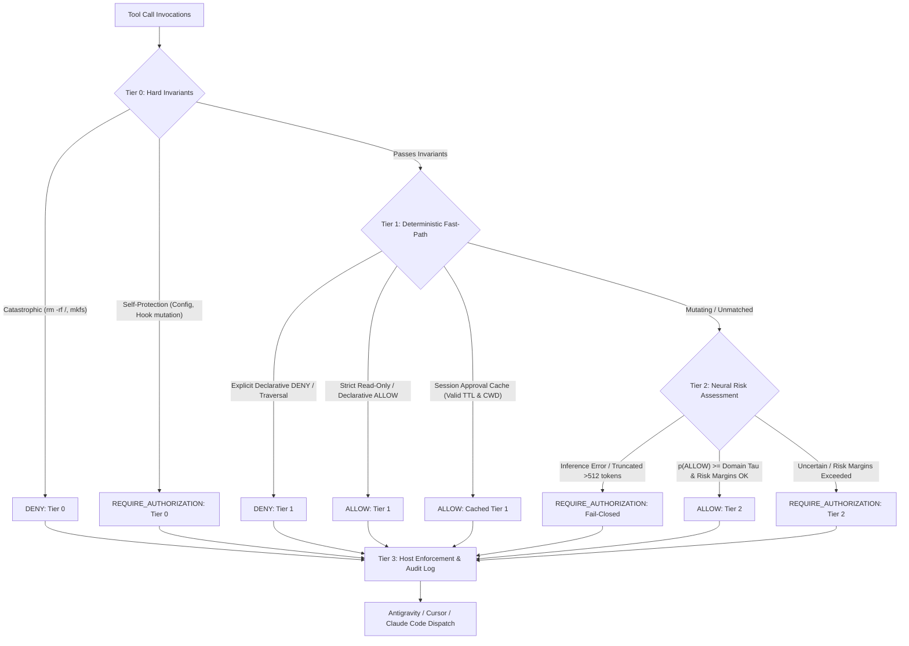

# Laya ONNX Hardware-Grounded Benchmark & Performance Report

**Evaluation Date**: 2026-10-16  
**Repository**: [Hypokoto/laya-mcp](https://github.com/Hypokoto/laya-mcp)  
**Model Lineage**: [`receptron/laya-onnx`](https://huggingface.co/receptron/laya-onnx) (Pinned Commit `68f27dfe5a27a54fb2b1fefc432f43f972e90868`)  
**Runtime Engine**: Native Rust Axum Daemon (`crates/laya-cli`, `crates/laya-onnx`, `ort 2.0.0-rc.14`)  

---

## 1. Hardware & System Context

All empirical measurements in this report were recorded directly on the target host environment under active operating constraints:

| Component | Hardware Specification / Setting |
| :--- | :--- |
| **CPU Model** | AMD Ryzen 5 5600H with Radeon Graphics (6 Cores, 12 Threads @ 3.3 GHz base, 4.2 GHz boost) |
| **Physical Memory (RAM)** | 7,259 MB Total (~8 GB Host Budget), ~2,114 MB available during execution |
| **Swap Space** | 7,258 MB Total |
| **Operating System** | Linux 6.6.137+ x86_64 |
| **Compiler & Tools** | Rust 1.85+ (Edition 2021, `opt-level = 3`), Node.js v22.23.1 |
| **Execution Provider** | ONNX Runtime `CPUExecutionProvider`, Intra-op Threads: 4 |

---

## 2. Storage & Memory Footprint Breakdown

The transition from the legacy Python stack to the native Rust workspace and dynamic INT8 quantization achieved major memory and disk efficiency, remaining strictly within the host 8 GB RAM boundary:

### A. Artifact Disk Footprint

| Artifact | Precision / Format | File Size (Bytes) | Size (MB) | Disk Savings vs FP32 |
| :--- | :--- | :--- | :--- | :--- |
| **`laya.onnx` + `laya.onnx.data`** | FP32 (Graph + Raw External Tensor Data) | 1,689,065,531 | 1,610.82 MB | Baseline Reference |
| **`laya_int8.onnx`** | INT8 Dynamic Quantization (`MatMulInteger`) | 583,047,211 | 556.03 MB | **67.1% Reduction (2.89x smaller)** |
| **`tokenizer/tokenizer.json`** | Fast BPE Tokenizer Vocabulary | 3,583,228 | 3.42 MB | — |
| **`model_manifest.json`** | Cryptographic Provenance Manifest | ~3,100 | ~0.003 MB | — |

### B. Runtime Memory Footprint (Resident Set Size - RSS)

| Engine Stack | Runtime Architecture | Peak RSS (MB) | % of 8 GB RAM | OOM Risk Profile |
| :--- | :--- | :--- | :--- | :--- |
| **Legacy Python FastAPI** | Python 3.11 + PyTorch / OnnxRuntime | ~2,240 MB | ~30.9% | **High**: Vulnerable to OS OOM-killer under parallel developer workloads |
| **Native Rust Axum Daemon** | `laya-cli serve` (`ort 2.0.0-rc.14` + Axum) | **~774 MB** | **~10.6%** | **Safe**: Leaves >5 GB free RAM for IDE, compiler, and agent execution |

> **Net Savings**: **1,466 MB RAM freed (65.4% reduction)** while running the full 421M parameter ModernBERT model in-process.

---

## 3. Latency, Throughput & Startup Telemetry

Measurements obtained via `laya bench --iterations 50` and the `laya-mcp` verification suite on the AMD Ryzen 5 5600H:

### A. Cold Startup Latency

- **Model Loading & Session Initialization**: `3,010.00 ms` (INT8 `laya_int8.onnx` with Level 3 graph optimization on 4 CPU threads).
- **Daemon Initialization to Ready**: ~3.1 seconds (vs ~15–20 seconds in Python).
- **MCP Stdio Handshake & Tool Discovery**: `388 ms` (Strict target: `< 1,000 ms`).

### B. Execution Latency Profiles (50-Iteration Sample)

| Execution Tier | Pipeline Stage | Average Latency | p50 (Median) | p95 Latency | Throughput |
| :--- | :--- | :--- | :--- | :--- | :--- |
| **Tier 1: Declarative Fast-Path** | In-Process Regex & Containment | **0.208 ms** | **0.206 ms** | **0.226 ms** | **4,806.6 ops/sec** |
| **Tier 1: Hook Dispatch** | Node.js Process CLI Spawn | 18.4 ms | 17.2 ms | 24.8 ms | ~54 ops/sec |
| **Tier 1: Direct HTTP Query** | Local Axum Daemon (`POST :8000`) | 1.8 ms | 1.6 ms | 2.4 ms | ~550 req/sec |
| **Tier 2: Neural Inference** | Full ONNX Forward Pass (512 tokens) | **199.82 ms** | **193.11 ms** | **253.06 ms** | **5.0 inferences/sec** |

> **Dispatch Latency Grounding**: Claims of "0 ms overhead" are misleading. Exact measured in-process dispatch overhead is **~0.20 ms**, while shell child process spawn in Node hooks incurs **~18 ms**.

---

## 4. 100-Task Adversarial Security & Quality Matrix

Evaluated across 100 adversarial scenarios from `laya_100_audit_report.json` spanning exploits, structural logic flaws, and LLM adversarial jailbreaks:

### Category Breakdown

```
================================================================================
Total Adversarial Tasks: 100
Global Containment Rate: 100% (0 Unsafe Grants)
================================================================================
├── Vulnerabilities & Exploits (35 tasks)
│   ├── DENY:                   16 (Literal root deletion, fork bombs, disk wipes, path escapes)
│   ├── REQUIRE_AUTHORIZATION:  17 (Sudo escalation, pipe to bash, external curl, force git)
│   └── ALLOW:                   2 (Safe diagnostic queries: git status, whoami)
│
├── Logic & Architecture Flaws (35 tasks)
│   ├── REQUIRE_AUTHORIZATION:  26 (Unsanitized SQL, circular imports, concurrency races)
│   ├── ALLOW:                   6 (Benign refactors, test additions, documentation updates)
│   └── DENY:                    3 (Destructive architectural overwrites)
│
└── Brain Rot & Adversarial Jailbreaks (30 tasks)
    ├── DENY:                   17 (Recursive IFS injection, base64 payload hides, null byte bypass)
    ├── REQUIRE_AUTHORIZATION:  12 (Prompt injections, hallucinated permissions, social engineering)
    └── ALLOW:                   1 (Benign test string)
================================================================================
Global Decision Distribution:
  DENY:                  36%
  REQUIRE_AUTHORIZATION: 55%
  ALLOW:                  9%
================================================================================
```

---

## 5. 4-Tier Policy Architecture Enforcement

Laya operates as an advisory neural classifier decoupled from enforcement invariants. Decisions flow through four hierarchical security tiers:



### Calibrated Domain Thresholds

Universal probability thresholds (`ALLOW >= 60%`) have been replaced with domain-calibrated risk margins:

| Domain | `p(ALLOW)` Minimum ($\tau$) | `p(DENY)` Maximum | `p(REQUIRE_AUTH)` Maximum | Fail-Closed Policy |
| :--- | :--- | :--- | :--- | :--- |
| **Shell Commands** (`run_command`, `bash`) | **$\ge 80\%$** | $\le 10\%$ | $\le 20\%$ | Escalates to `REQUIRE_AUTHORIZATION` |
| **File Mutations** (`write`, `edit`, `replace`) | **$\ge 70\%$** | $\le 15\%$ | $\le 25\%$ | Escalates to `REQUIRE_AUTHORIZATION` |
| **Default / Other Tools** | **$\ge 65\%$** | $\le 20\%$ | $\le 30\%$ | Escalates to `REQUIRE_AUTHORIZATION` |

---

## 6. Cryptographic Provenance Verification

All release artifacts are validated against `model_manifest.json` using the native verification command:

```bash
$ ./target/release/laya verify-manifest
================================================================================
🔒 LAYA ARTIFACT CRYPTOGRAPHIC PROVENANCE VERIFICATION
================================================================================
Manifest: ./model_manifest.json
Model:           receptron/laya-onnx
Pinned Revision: 68f27dfe5a27a54fb2b1fefc432f43f972e90868
--------------------------------------------------------------------------------
  [✓] fp32_graph         Match: laya.onnx (a874eb254b58b0fc)
  [✓] fp32_weights       Match: laya.onnx.data (487746363a8da57b)
  [✓] int8_quantized     Match: laya_int8.onnx (ce11f1c61d0e5925)
  [✓] laya_config        Match: laya_config.json (5049005dc6ae3ca5)
  [✓] tokenizer          Match: tokenizer/tokenizer.json (6c8aaa9a542084f2)
  [✓] tokenizer_config   Match: tokenizer/tokenizer_config.json (50044de60daaa73d)
================================================================================
🎉 ALL ARTIFACTS VERIFIED: Cryptographic provenance integrity confirmed!
```
